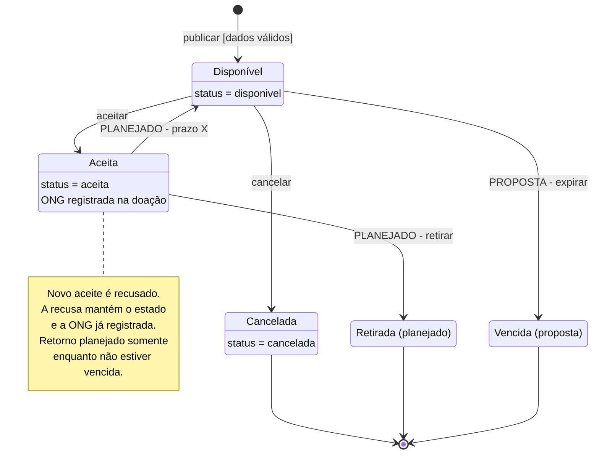

# Estados da doação — versão revisada

Parte 4 da atividade de diagramas: ciclo de vida de **uma doação**, conferido com
as histórias, as regras de negócio e o código desta revisão. A versão original
está preservada em [original-ia/ia-estados.md](original-ia/ia-estados.md).

## Diagrama

Publicação, aceite e cancelamento antes do aceite estão implementados nesta
revisão. Retirada e seu encerramento são planejados; Vencida e seu encerramento
são propostas da revisão crítica, ainda sem implementação. O retorno após o
prazo permanece planejado. `X` é um prazo não definido pelo grupo.

O ponto inicial representa a criação de uma doação persistida. Uma publicação
recusada não cria uma doação nem um estado de erro. O ponto final representa o
encerramento do ciclo de vida; não significa apagar o registro do banco.

## Regras e alcance da implementação

| Operação | Comportamento conferido | Situação |
|---|---|---|
| Publicar | Exige tipo, quantidade e validade; recusa data inválida ou anterior ao início do dia usado pela validação; insere com `status = 'disponivel'`. | Implementado em `criarDoacao`, `inserir` e no valor padrão do schema. |
| Listar | Retorna apenas `status = 'disponivel'`, na ordem de criação. Consultar a lista não altera o estado. | Implementado em `listarDisponiveis`. |
| Aceitar | Atualiza para `aceita` e registra `ong` somente se o registro ainda estiver `disponivel`. O `UPDATE` condicional protege contra dois aceites da mesma doação. | Implementado em `aceitar`. |
| Recusar novo aceite | Doação inexistente ou fora de `disponivel` não é atualizada; a API responde com erro. A recusa não é uma transição para outro estado nem uma transição de saída e reentrada em Aceita. | Implementado nas camadas de repositório, regra e API. |
| Cancelar antes do aceite | Atualiza para `cancelada` apenas se o registro ainda estiver `disponivel`. Mantém o registro e o remove da listagem de disponíveis. Doação aceita não pode ser cancelada por essa operação. | Implementado nesta revisão por `POST /api/doacoes/:id/cancelar`, com atualização condicional no repositório. |
| Confirmar retirada | Encerra a doação que foi aceita pela ONG. | Comportamento de projeto; sem rota ou implementação de retirada. |
| Liberar após o prazo | Uma doação aceita e não retirada volta a Disponível após `X` horas, desde que ainda esteja dentro da validade. Será necessário liberar também a associação com a ONG. | Planejado; ainda não há prazo configurado, instante de aceite persistido ou rotina de liberação. A guarda de validade é parte da correção proposta. |
| Expirar | Uma doação disponível passa a Vencida quando ultrapassa a validade; não pode voltar para a lista. | Proposta da revisão crítica; sem persistência desse estado ou rotina de expiração. |

**Limites atuais:** informar `ong` não autentica a organização. O schema não
registra a identidade do doador e não existe autorização por usuário. A validade
é verificada na publicação, mas não é reavaliada na listagem nem no aceite;
portanto, não há estado Vencida ou expiração automática implementada. A regra
do limite de `N` doações pendentes por ONG também permanece planejada. Definir
`N`, `X` e como executar a expiração é uma decisão pendente. A política para uma
doação que vence enquanto está Aceita também precisa ser definida; o diagrama
não atribui uma transição a esse caso.

**Inferência de projeto:** a guarda de validade no retorno após `X` horas foi
acrescentada para impedir a redisponibilização de alimento vencido. Não é uma
regra já implementada nem uma definição explícita da revisão crítica. A
implementação futura precisa conferir a validade no aceite e na liberação,
além de definir como tratar a doação que venceu durante a reserva.

## Ajustes em relação ao diagrama anterior

1. **Implementado e planejado identificados nas transições.** Marcar apenas os
   estados futuros deixava o retorno após `X` horas com aparência de pronto.
   Cancelada passa a ser implementada com a história entregue nesta revisão.
2. **Recusa de aceite representada como regra, sem autotransição.** Uma tentativa
   recusada não altera o status nem substitui a ONG que já aceitou a doação.
3. **Validade contemplada na proposta.** Vencida cobre o alimento que ultrapassa
   a validade depois da publicação. A liberação após `X` horas precisa verificar
   a validade para que esse alimento não volte a ficar disponível.
4. **Encerramento explícito.** Cancelada, Retirada e Vencida apontam para o estado final;
   a preservação do registro continua compatível com a necessidade de histórico.
5. **Cancelamento após aceite sem permissão inventada.** A regra 2 da análise
   exige contato direto com a coordenação, mas não define uma funcionalidade que
   autorize a coordenação a cancelar pelo sistema. Por isso, a seta
   `Aceita → Cancelada` do original foi removida até que esse fluxo seja definido.
6. **Guardas e lacunas documentadas.** A publicação passa pelas validações
   existentes, o aceite depende do estado disponível e requisitos ainda não
   implementados não são apresentados como garantias do produto.

## Rastreabilidade

| Elemento | Fonte e evidência |
|---|---|
| Publicação, listagem e aceite | [Análise, histórias 1–3](analise.md); [`src/doacoes.js`](../src/doacoes.js), [`src/repositorio.js`](../src/repositorio.js), [`src/app.js`](../src/app.js) e [`src/db.js`](../src/db.js); cenários existentes em [`tests/doacoes.test.js`](../tests/doacoes.test.js). |
| Aceite exclusivo | [Decisão 1 do projeto](projeto.md): a primeira ONG que efetivar o aceite fica com a doação; condição `WHERE status = 'disponivel'` no repositório. |
| Cancelamento | [Análise, regra de negócio 2](analise.md); funções `cancelar` em [`src/doacoes.js`](../src/doacoes.js) e [`src/repositorio.js`](../src/repositorio.js), rota em [`src/app.js`](../src/app.js) e cenários em [`tests/cancelamento.test.js`](../tests/cancelamento.test.js). |
| Prazo e retirada | [Análise, regra de negócio 3](analise.md); [Decisão 3 do projeto](projeto.md). A retirada também aparece nos eventos previstos pela Decisão 2 e pelo RNF01. |
| Proposta Vencida e recusa sem autotransição | [Revisão crítica da Parte 3, PR #10](https://github.com/daniela-luisa/Projeto-Prato-Cheio/pull/10), problemas 3 e 4. Vencida precisa de uma história e testes próprios antes de ser considerada implementada. A guarda de validade na liberação é uma inferência adicional, explicitada acima. |
| Histórico | [Risco 1 da análise](analise.md), [Decisão 2 e RNF01 do projeto](projeto.md): a tabela de eventos é planejada. O código atual atualiza a mesma linha de `doacoes`; o diagrama não afirma que já há histórico auditável. |
| Banco e hospedagem | [ADR 0001](adr/0001-postgresql-como-banco.md) e [ADR 0003](adr/0003-hospedagem-para-varias-cidades.md), que substitui o [ADR 0002](adr/0002-hospedagem-do-postgresql.md). Essas decisões não criam novos estados de negócio. O código conferido ainda usa SQLite. |

**Divergência documental encontrada:** a seção 5 de `analise.md` descreve o
aceite como uma próxima fatia, e o README ainda apresenta funções como pendentes.
O código e os testes já contêm publicação, listagem e aceite; essa evidência é a
base para marcar essas operações como implementadas neste diagrama.