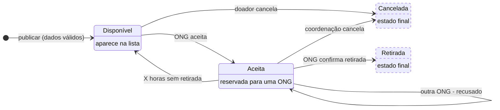

# Estados da doação — versão original gerada pela IA

Gerada pelo Claude em 07/10/2026, sem correções. A IA entregou o diagrama como imagem; este arquivo é a transcrição em Mermaid com os mesmos elementos, incluindo os erros analisados no README.

Estados tracejados: planejados.
